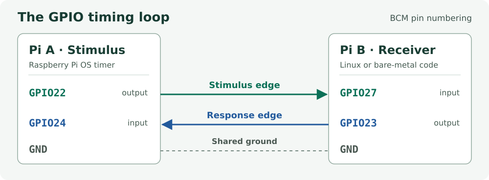
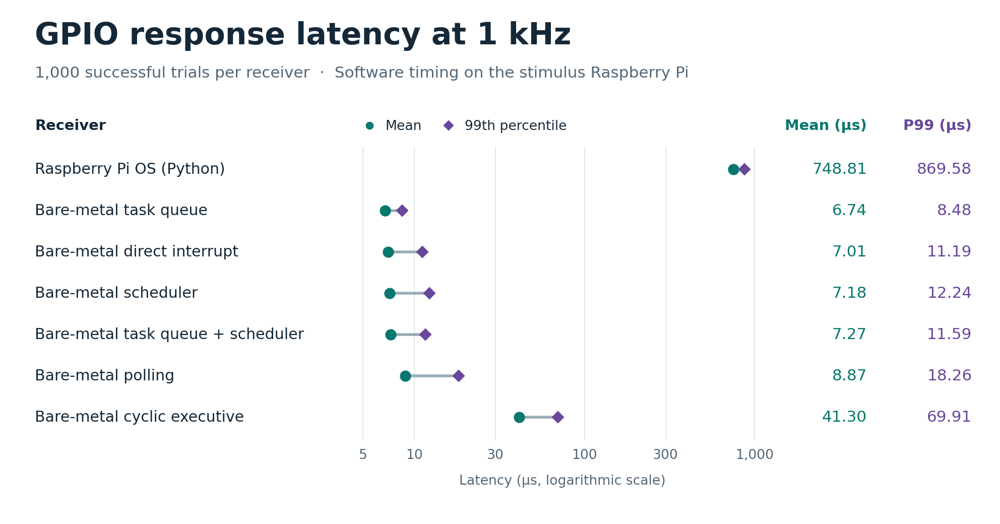
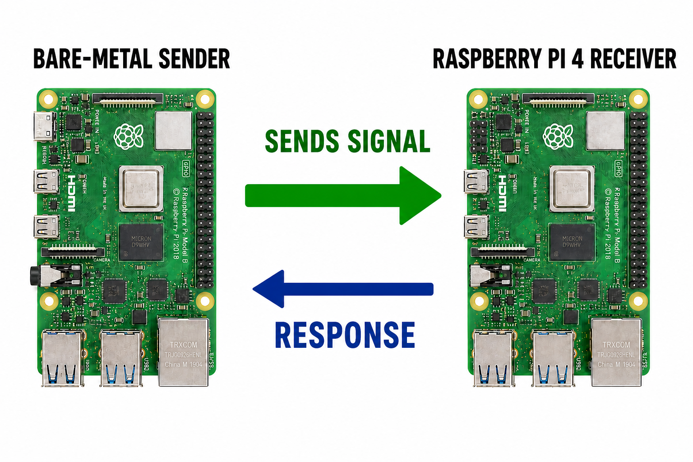

# How fast can a Raspberry Pi react?

**Evaluating GPIO response latency on the Raspberry Pi 4**

Umba Lubembele · Computer Science, Bishop’s University · Summer 2026 research internship

When one Raspberry Pi raises a GPIO pin, how long does a second Pi take to answer? I built a two-board test rig and changed the software on the receiving Pi to see how polling, interrupts, task queues, and scheduling affect both a typical response and a slow one.

**At 1 kHz, the bare-metal interrupt + task queue averaged 6.74 µs per response. The Python receiver on Raspberry Pi OS averaged 748.81 µs.** Both answered all 1,000 recorded signals in their respective runs. Their 99th-percentile latencies were 8.48 µs and 869.58 µs.

[Read the research report (PDF)](report/gpio-latency-report.pdf) · [Explore the raw measurements](data/raw_csv/) · [Reproduce the plots](analysis/)

## June experiment · periodic signals

Pi A ran Raspberry Pi OS. A Python program drove the stimulus line high, watched for the returning edge, and timed the exchange with `perf_counter_ns()`. Pi B ran one receiver implementation at a time. During bring-up, an LED on Pi B’s GPIO18 showed that the custom AArch64 kernel had booted and could respond to the input.

The June 10–11 comparison used four stimulus rates (1, 10, 100, and 1,000 Hz) and recorded **27,918 successful responses** across seven configurations. Every number below includes Pi A’s Python, GPIO-library, and Linux scheduling overhead. The comparison describes the full software-timed exchange.

## What changed on the receiver?

| Receiver | How it produced a response |
| --- | --- |
| Raspberry Pi OS / Python | The Linux receiver script detected the input change through gpiozero and updated the output. |
| Bare-metal polling | A loop checked the input continuously and mirrored each change. |
| Direct interrupt | The GPIO interrupt handler updated the response pin itself. |
| Interrupt + task queue | The handler queued the event. The main loop performed the GPIO update. |
| Scheduler | The handler marked a task ready, and the scheduler dispatched it. |
| Cyclic executive | A fixed repeating cycle sampled the input and updated the output. |
| Task queue + scheduler | The handler queued the work, then the scheduler dispatched the response task. |

The early development notes trace these designs from the first blinking LED through two-way signaling and interrupt-controller bring-up. [Read the original notes](report/development-notes.txt).

## Results at 1 kHz

The direct interrupt and task queue had similar means (7.01 and 6.74 µs), but the slow end of the runs differed. The direct interrupt’s 99th percentile was 11.19 µs, compared with 8.48 µs for the task queue. The longest responses observed were 30.89 and 22.39 µs respectively. Each percentile describes the recorded run. A future signal can take longer.

At 10 Hz the ranking changed. The **task queue + scheduler** had the lowest mean (21.04 µs) and 99th percentile (35.02 µs) among the bare-metal designs. [Compare all four rates](analysis_tables/canonical_main_results_lower.csv).

## August poster · high-rate bursts

The August poster draft describes a second experiment. It compared six receiver methods using bursts of 1,000 signals, with intervals from 100 µs down to 15 µs. At 15 µs, a new signal arrives about 66,700 times per second. At that pace, counting how many events a receiver handles matters as much as timing the ones it answers.

The draft reports that **Linux C with memory-mapped GPIO** had the lowest measured latency and answered all 1,000 events. **Direct interrupts** performed best among the bare-metal receivers. The scheduler handled 843 events and missed 157 in the reported burst comparison. These are poster-reported outcomes. The raw CSVs in this repository cover the June experiment.

*August project illustration. The June data above used a Raspberry Pi OS sender.*

## How to read the June data

- The report uses one run per receiver and rate. The Raspberry Pi OS 1 Hz file contains **918 valid responses**. The other 82 planned trials have no recorded outcome.
- The 35 raw files also include two short additional runs and five experimental multicore runs. Multicore recorded **83 missed responses and zero successful responses**, so there is no latency estimate for that design. [Inspect the run inventory](analysis_tables/all_uploaded_run_inventory.csv).
- Raw files store nanoseconds and microseconds. The report and README use microseconds. P95 and P99 use the lower observed value at the percentile position. [View the report’s canonical table](analysis_tables/canonical_main_results_lower.csv).

## Repository guide

| Path | Contents |
| --- | --- |
| [report/](report/) | Full report in PDF and Word, including the method, results, and histogram appendix, plus the earlier bring-up notes |
| [data/raw_csv/](data/raw_csv/) | Original per-run captures, including partial runs and the experimental multicore captures |
| [data/](data/) | Original aggregate point and summary files alongside the raw captures |
| [analysis_tables/](analysis_tables/) | Report tables identifying the runs used in the main comparison and the status of every recorded run |
| [plots/](plots/) | 44 submitted figures, including distribution plots, box plots, and per-receiver histograms |
| [analysis/](analysis/) | Python plotting workflow and instructions for reproducing the figures from the data |

The analysis runs on a desktop without Raspberry Pi hardware. The published files cover data analysis and the research record. Appendix C lists the on-board acquisition scripts and receiver firmware separately. Their original source files are unavailable in this archive.
